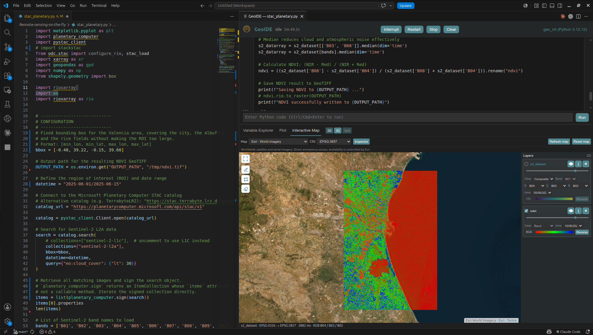
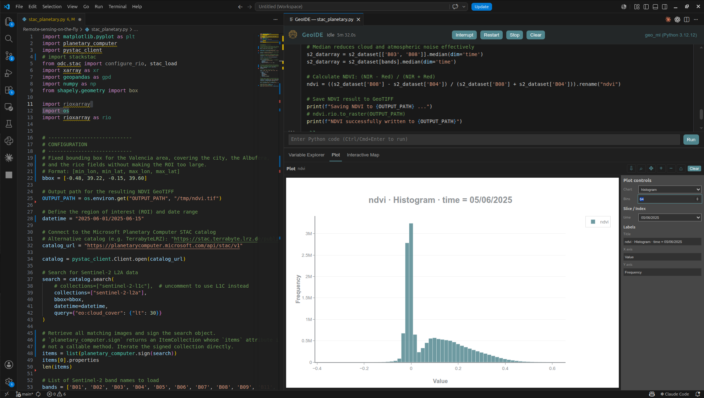
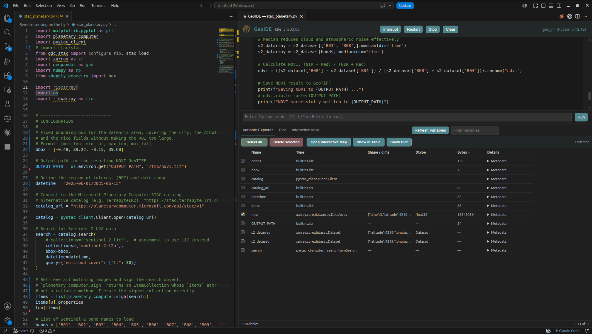

# GeoIDE

**Earth Data Science**

GIS, Scientific Variables and Interactive Maps for Visual Studio Code.

**Interactive Python Console · Variable Explorer · Scientific Plots · Geospatial Views**

GeoIDE is a free Visual Studio Code extension that keeps Python execution, scientific data inspection and spatial exploration together in one workspace.

This public repository is the official information and support page for GeoIDE. It does **not** contain the proprietary development source code.

## Video demo

[Watch GeoIDE load, display and explore Sentinel-2 and NDVI data in a 53-second screen recording (MP4, no audio).](media/geoide-ndvi-demo.mp4)

[Download the original WebM recording.](media/geoide-ndvi-demo.webm)

## Interactive Map — 2D and 3D



- Explore raster and vector data over a worldwide satellite basemap.
- Choose bands, dates and RGB composites; adjust colours, opacity and layer order.
- View supported Point Clouds in 2D or 3D, inspect points and measure distances.

## Interactive Plots



- Create histograms, scatter plots and time series directly from compatible variables.
- Pan, zoom, reset and download the current view.

## Variable Explorer



- Inspect NumPy, pandas, xarray and supported geospatial variables.
- Select any variable and delete selected values from the current Python session after confirmation.

## Main features

- Run Python files, selections and `# %%` cells in persistent per-file sessions.
- Use **Run Cell**, **Run Above** and **Run Below** without the VS Code Jupyter extension.
- Inspect NumPy, pandas and xarray variables and delete selected variables from memory.
- Create plots and inspect supported raster, vector and point-cloud data.
- Use worldwide satellite imagery and additional online or network-free map backgrounds.

## Requirements

- Visual Studio Code 1.90 or later.
- A local Python environment containing:

  ```bash
  python -m pip install "ipykernel>=6.29,<8" "jupyter_client>=8.6,<9"
  ```

- The scientific packages needed by your own work, such as NumPy, pandas, xarray, GeoPandas, Rasterio or Matplotlib.

GeoIDE does not install or update Python packages automatically.

## Getting started

1. Install GeoIDE from Visual Studio Marketplace when the public listing is available.
2. Open a trusted workspace and a Python file.
3. Run **GeoIDE: Select Python Environment** from the Command Palette.
4. Add a cell marker and run the cell:

   ```python
   # %%
   import numpy as np
   values = np.arange(100).reshape(10, 10)
   values.mean()
   ```

5. Inspect `values` in the Variable Explorer and open a plot, table or map when supported.

## Support and bug reports

Use [GitHub Issues](https://github.com/ferranfal/GeoIDE-support/issues) for questions and reproducible problems. Before opening an issue, please include:

- GeoIDE version and Visual Studio Code version;
- operating system and whether the workspace is local, SSH, WSL or another remote host;
- Python version and the relevant package versions;
- a small example using synthetic or non-confidential data;
- the exact error message or a screenshot with private information removed.

GeoIDE can export a filtered diagnostic report through **GeoIDE: Export Diagnostics**. Review it before sharing. Do not publish credentials, private paths, proprietary datasets or personal information.

## Data and online services

Python runs in the environment selected by the user. GeoIDE does not include analytics telemetry or a hosted data-upload service. Online map backgrounds contact their providers directly; those providers receive the connection IP address and the tile coordinates required for the visible area. Provider terms, attribution requirements and availability apply separately.

## License

GeoIDE is free to use, including for commercial work, under the [GeoIDE Free-of-Charge Proprietary Software License](LICENSE). It is not open-source software. Third-party components and services retain their own terms and notices.
